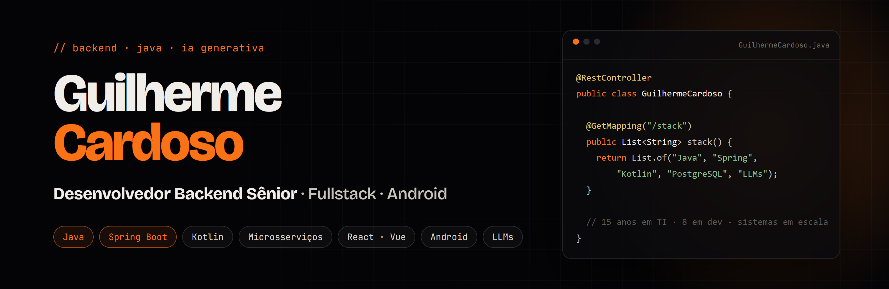

  Backend Java como base, <b>fullstack</b> no dia a dia e apps <b>Android</b> publicados na Google Play. 
  EN · Senior Backend &amp; Fullstack Developer — Java, Spring Boot, microservices, Android and production-grade GenAI.

  
  
  
  
  
  

---

### Sobre

15 anos em tecnologia, 8 deles como desenvolvedor. Comecei pela infraestrutura (servidores, bancos e nuvem) e hoje atuo em **sistemas de grande porte**. Faço os dois lados: evoluo e modernizo sistemas legados sem quebrar o que está em produção e construo projetos novos do zero, como uma plataforma de billing em microsserviços. Além do backend, atuo como **fullstack** (React, Vue, Angular, Next.js) e desenvolvo **apps Android**, com dois deles publicados. Também levo IA generativa para a produção.

### Trajetória

| Período | Onde | O que faço / fiz |
|---|---|---|
| **2026 –** | **Elumini IT** · mercado financeiro | Backend Java para o mercado de capitais |
| **2025 – 2026** | **Insi** · grande grupo de mídia | Desenvolvimento do principal sistema de RH do grupo · API REST em Spring Boot · assistente de IA conversacional com LLM (Gemini / Vertex AI, function calling) · métricas para painéis gerenciais |
| **2025 – 2026** | **Tratum** · PJ · análise de risco e crédito | Microsserviços em Kotlin / Micronaut · Elasticsearch · Kubernetes · New Relic · frontend em React |
| **2024 – 2025** | **Compass UOL** | Projeto novo de **billing**: microsserviços em Java (Spring Boot) e Python · Azure (AKS / Kubernetes, Blob Storage) |
| **2021 – 2024** | **Yggdrasil · Ilog · Valide** | Microsserviços, dashboards e app em Flutter · fullstack em um dos maiores LMS da América Latina · C# / AngularJS |
| **2016 – 2021** | **Analista de Sistemas** | Infraestrutura, SQL Server, VMware, Windows Server, rotinas de backup e nuvem |
| **Paralelo** | **Hermi Consultoria** · fundador | SaaS, integrações oficiais com WhatsApp / Meta e agentes de IA |

### Stack

<table>
  <tr>
    <td width="170"><b>☕ Backend</b></td>
    <td>      </td>
  </tr>
  <tr>
    <td width="170"><b>🗄️ Dados</b></td>
    <td>    </td>
  </tr>
  <tr>
    <td width="170"><b>☁️ Cloud e DevOps</b></td>
    <td>    </td>
  </tr>
  <tr>
    <td width="170"><b>🤖 IA generativa</b></td>
    <td>    </td>
  </tr>
  <tr>
    <td width="170"><b>🖥️ Frontend</b></td>
    <td>     </td>
  </tr>
  <tr>
    <td width="170"><b>📱 Android e mobile</b></td>
    <td>    </td>
  </tr>
  <tr>
    <td width="170"><b>🧩 Também uso</b></td>
    <td>  </td>
  </tr>
</table>

📚 Em andamento: AWS Certified AI Practitioner

### Produtos que criei

<table>
  <tr>
    <td width="50%" valign="top">
      <b>📖 Leafy Book Reader</b> 
      Leitor gratuito de livros e audiolivros para Windows e Android (EPUB, PDF, MOBI, quadrinhos), com sincronização e Google Drive. 
      <a href="https://leafybook.app">Site</a> · <a href="https://github.com/gdcodedev/Leafy-Book-Reader-Windows">Repositório</a>
    </td>
    <td width="50%" valign="top">
      <b>💬 SaaS de atendimento</b> 
      Multiatendimento pela API oficial do WhatsApp e do Instagram, com CRM e agente de IA nativo. 
      <a href="https://www.hermiconsultoria.com.br">Site da Hermi</a> · <i>código fechado</i>
    </td>
  </tr>
  <tr>
    <td width="50%" valign="top">
      <b>🖥️ Hermi Desk</b> 
      Suporte remoto com a marca da empresa: cliente instalável, painel de dispositivos e servidor próprio. 
      <i>Hermi Consultoria · código fechado</i>
    </td>
    <td width="50%" valign="top">
      <b>🏝️ Ilha das Sílabas</b> 
      Jogo de alfabetização infantil para Android. 
      <a href="https://play.google.com/store/apps/details?id=com.ilhadassilabas.jogo">Google Play</a> · <i>Hermi Consultoria</i>
    </td>
  </tr>
</table>

---

  

